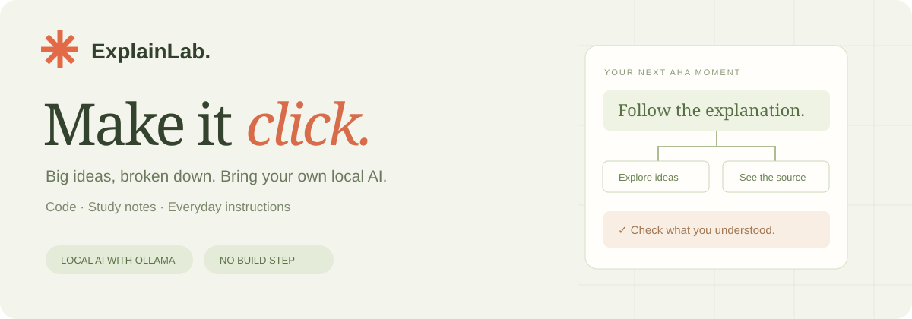

# ExplainLab

**Turn a difficult passage into an explanation you can explore.**

Paste code, study notes, or everyday instructions. ExplainLab builds a plain-language explanation, an interactive concept map, a practical walkthrough, and a short quiz. Click a source reference to see the passage behind a claim.

Run the included samples immediately, or connect a locally running Ollama model to explain your own text.

## Try it in a minute

You need **Node.js 22 or newer**. This repository has no external npm dependencies and requires no build step.

Clone the repository and start the app:

```sh
git clone https://github.com/logeswar589/explainlab.git
cd explainlab
npm start
```

Open [http://127.0.0.1:4173](http://127.0.0.1:4173).

The JavaScript debounce lesson is a **curated sample**. Switch to photosynthesis or the fictional camera guide to explore the same tools with different subjects. These prewritten samples need no model, API key, or account; loading one does not perform AI inference.

## Explain your own text

1. Install and start [Ollama](https://docs.ollama.com/quickstart).
2. Download a local text model that fits your computer using Ollama. Choose a model you have installed rather than assuming every model will run on your hardware.
3. Open ExplainLab's model settings and select an available model.
4. Paste a passage of 80–20,000 characters, choose an audience and depth, and generate a lesson.

Live generation needs a running Ollama service and a downloaded model. Model quality, speed, memory use, and ability to follow the output format vary. The app reports connection or validation errors; it does not quietly replace a failed generation with sample content.

## What you can do

- **Explore an explanation:** read a summary, concepts, analogies, and a step-by-step walkthrough.
- **Follow the concept map:** select a concept to inspect its details and its links to other ideas.
- **Check yourself:** answer multiple-choice questions and read feedback.
- **Inspect source passages:** each reference points to a numbered paragraph from the input.
- **Keep a local library:** explicitly save a lesson in this browser for later.
- **Export a lesson:** download Markdown or JSON for your notes or another tool.

The three audience modes—developer, student, and everyday—change the way the model explains the input. They do not verify its subject-matter accuracy.

## Data and privacy

The app runs on `127.0.0.1` by default. To generate a lesson, the browser sends the source to the ExplainLab server, which sends it to the configured Ollama endpoint. The default endpoint is `http://127.0.0.1:11434`.

Sources and generated lessons are retained in browser storage only when you explicitly choose **Save**. They remain in that browser profile until deleted or browser site data is cleared. Exports contain the lesson and source material, so review them before sharing. The app does not maintain a server-side lesson library, and its logs should not include source text.

Use a locally installed model if you want local inference. Changing the server's `OLLAMA_URL` or using a model served through a remote provider changes where your input may go. Your Ollama installation and any provider it uses have their own data handling behavior.

## Configuration

| Environment variable | Default | Purpose |
| --- | --- | --- |
| `PORT` | `4173` | ExplainLab's local HTTP port |
| `OLLAMA_URL` | `http://127.0.0.1:11434` | Ollama endpoint contacted by the server |
| `OLLAMA_MODEL` | unset | Optional default model name |

Set environment variables before starting the app. See [`.env.example`](.env.example) for the names. A `.env` file is not loaded automatically; to use one with Node's built-in support:

```sh
node --env-file=.env server.mjs
```

The browser cannot supply an arbitrary Ollama endpoint. Endpoint configuration belongs to the person running the server.

## Development

```sh
npm test
```

Tests run with Node's built-in test runner. See [the architecture notes](docs/ARCHITECTURE.md) for the request flow and lesson format, and [CONTRIBUTING.md](CONTRIBUTING.md) for contribution guidance.

See [verification notes](docs/VERIFICATION.md) for the tested environment and remaining checks, and [launch notes](docs/LAUNCH.md) for the early-user plan.

## Limitations

ExplainLab is an early local prototype. A plausible explanation can still be wrong, incomplete, or misleading. **Source references provide traceability, not verification:** they show which input paragraph a claim points to, not whether that paragraph proves the claim. The model can also misunderstand or overextend the source.

Inputs are plain text. There is no URL crawling, PDF import, retrieval system, independent fact checker, account system, or multi-user synchronization. The server is designed for local use and does not include public-service authentication or usage controls. Keep it on loopback unless you add suitable deployment protections.

The included source passages and sample lessons are original educational examples. The camera and its controls are fictional.

## Contributing

Useful contributions include clearer error messages, accessibility improvements, better model compatibility, and reproducible examples of unsupported claims. Start with [CONTRIBUTING.md](CONTRIBUTING.md). For security concerns, see [SECURITY.md](SECURITY.md).

Released under the [MIT License](LICENSE).
